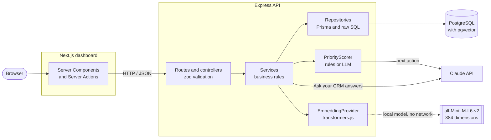

# PilotDeal

An AI-assisted mini CRM that tells you which deal to work on next, and answers questions about your customers from your own notes.

[](https://github.com/GabiYlw/PilotDeal/actions/workflows/ci.yml)
[](LICENSE)

**Live demo:** [demo.pilotdeal.online](https://demo.pilotdeal.online) _(coming soon)_

<!--
Screenshots: add the images to docs/screenshots/ and uncomment.

| Deals ranked by priority | Deal with next best action | Ask your CRM |
|---|---|---|
|  |  |  |
-->

_Screenshots coming soon._

## Features

- **Priority scoring.** Every open deal gets a score from 0 to 100, computed by transparent rules: days since the last interaction, deal value, stage and expected close date. Each score comes with the factors that produced it, so it can be explained.
- **Next best action.** On a deal's page, Claude reads the recent interactions and suggests the next best action. It may adjust the rule-based score by **at most 20 points**, and the adjustment is shown as its own factor. Without an API key, or if the model fails, the rule-based action is used.
- **Ask your CRM.** Ask a question in plain English ("Who is worried about pricing?"). The API retrieves the most relevant interaction notes by semantic search (RAG) and Claude answers **only from those notes, with citations** to its sources. Questions can be scoped to a single deal.
- **CRM basics.** Companies, contacts, deals and interactions with create, edit and delete, in a minimalist dashboard with light and dark themes.

## Architecture



The browser only talks to the Next.js server. The web app fetches data on the server and calls the API over HTTP; it holds no business logic. The API owns every rule, including scoring, and is the only part that talks to the database or to Claude.

### Tech stack

| Area | Technologies |
|---|---|
| API | Node.js 22, TypeScript (strict), Express 5, zod 4, Prisma 7 |
| Database | PostgreSQL 16 with pgvector |
| AI | Claude via `@anthropic-ai/sdk` (default model `claude-haiku-5-5`), local embeddings with `@huggingface/transformers` (`Xenova/all-MiniLM-L6-v2`) |
| Web | Next.js 16 (App Router, Cache Components), React 19, Tailwind CSS 4, Geist font |
| Testing | Vitest, Supertest, React Testing Library |
| Tooling | ESLint, Prettier, Docker Compose, GitHub Actions |

## AI engineering

- **Structured output, validated.** Claude answers through a tool call with a JSON schema, and the result is validated again with zod before it is used. Nothing the model returns is trusted until it passes the schema.
- **Fallback to rules on any LLM failure.** A missing API key, a timeout, an HTTP error or an invalid response all lead to the rule-based result. The app works fully without an API key; failures are logged as warnings without notes, questions or keys.
- **Bounded influence.** The LLM can move a priority score by at most ±20 points around the rule-based baseline, so a wrong or manipulated answer cannot reorder the pipeline on its own.
- **Grounding check.** Each retrieved note gets a label (`S1`, `S2`, ...). An answer must cite at least one label that was actually retrieved; otherwise it is rejected and only the sources are shown. The model can also say that the notes do not contain the answer.
- **Prompt injection protection.** Notes, questions, deal titles and company names are HTML-escaped and placed inside delimited tags, and the system prompt tells the model to treat them strictly as data, never as instructions.
- **Model output rendered as text only.** Answers are displayed as React text, never as HTML or Markdown, so a model output cannot inject markup or scripts into the page.
- **Local embeddings.** Notes are embedded on the API server with transformers.js when an interaction is created or its notes change. No customer text leaves the server for embedding, and there is no per-request embedding cost. The Docker image downloads the model at build time and runs offline.
- **Exact cosine search instead of an HNSW index.** Retrieval uses pgvector's exact cosine distance. At CRM scale (thousands of notes) it is fast, it always returns the true nearest neighbours, and it stays correct when combined with filters such as a deal scope. An approximate HNSW index only becomes worth it at hundreds of thousands of interactions.

### Limitations and next steps

- **No evaluation set yet.** Retrieval quality and answer quality are covered by tests of the logic around the model, not measured against a labelled set of questions. Building a small evaluation set is the next step.
- **No agent with tools yet.** Ask your CRM answers from retrieved notes in one step; it cannot yet query deals, values or dates through tools.
- **Single user, no authentication.** There are no accounts or permissions yet, so it is not ready for real customer data.

## Getting started

### Quick start with Docker

Requires Docker with Compose.

```bash
git clone https://github.com/GabiYlw/PilotDeal.git
cd PilotDeal

# Optional: enable Claude features. Without a key, scoring is rule-based and
# Ask your CRM returns the most relevant notes without a generated answer.
cp .env.example .env   # then set ANTHROPIC_API_KEY

docker compose --profile full up -d --build --wait
docker compose --profile full exec api node dist/prisma/seed.js
```

Open [http://localhost:3000](http://localhost:3000). The API runs on [http://localhost:3001](http://localhost:3001) (`/health` reports the database status). The first build downloads the embedding model into the API image, so it takes a few minutes.

Stop with `docker compose --profile full down` (the database volume is kept).

### Local development

Requires Node.js 22 and Docker (for the database only).

```bash
docker compose up -d db                 # PostgreSQL with pgvector, plus the test database

cp api/.env.example api/.env            # optional: set ANTHROPIC_API_KEY
npm --prefix api install
npm --prefix api run migrate            # apply the migrations
npm --prefix api run seed               # sample data; the first run downloads the embedding model
npm --prefix api run dev                # API on http://localhost:3001

cp web/.env.example web/.env.local
npm --prefix web install
npm --prefix web run dev                # dashboard on http://localhost:3000
```

Stop the local dev servers before starting the Docker `full` profile: both use ports 3000 and 3001.

### Environment variables

| Variable | Where | Required | Description |
|---|---|---|---|
| `DATABASE_URL` | `api/.env` | yes | Development database |
| `DATABASE_URL_TEST` | `api/.env` | for integration tests | Separate test database, never the development one |
| `PORT` | `api/.env` | no (3001) | API port |
| `ANTHROPIC_API_KEY` | `api/.env`, root `.env` for Docker | no | Enables LLM next actions and generated answers |
| `ANTHROPIC_MODEL` | `api/.env`, root `.env` for Docker | no (`claude-haiku-5-5`) | Claude model |
| `EMBEDDING_CACHE_DIR` | `api/.env` | no | Where the embedding model is cached |
| `EMBEDDING_OFFLINE` | `api/.env` | no (`false`) | `true` uses only the cached model and never downloads it |
| `API_URL` | `web/.env.local` | yes | Base URL of the API, read on the server only |

Every variable is validated at startup, and the API fails fast with a clear message if a required one is missing.

### Seeding

The seed creates 5 companies with contacts, deals in every stage and realistic interaction notes, then embeds the notes. It **deletes existing data first**.

- Local: `npm --prefix api run seed`
- Docker: `docker compose --profile full exec api node dist/prisma/seed.js`

`npm --prefix api run embed:backfill` embeds any interaction that is missing an embedding.

### Running tests

```bash
npm --prefix api run test:unit          # services and scorers, no database, no network
npm --prefix api run test:integration   # HTTP endpoints against the test database (docker compose up -d db)
npm --prefix web run test               # components and Server Actions with a mocked API
```

Tests never call the real Claude API or download the embedding model; both are replaced by fakes. Lint, typecheck and format checks run with `lint`, `typecheck` and `format:check` in each package. GitHub Actions runs all of them, plus the production build and both Docker image builds, on every push and pull request.

## AI-assisted development

PilotDeal was built with [Claude Code](https://claude.com/claude-code).

- **Project rules in [`CLAUDE.md`](CLAUDE.md):** architecture layers, coding conventions, the design system, testing rules and the commands to run before a task counts as done.
- **A multi-agent feature pipeline** in [`.claude/`](.claude): a **planner** writes the spec, a **coder** implements it, a **tester** writes and runs tests against every acceptance criterion, and a **reviewer** reviews the result, looping until it passes. It is based on a pipeline a friend shared with me. I fixed it so the reviewer also sees new untracked files, not only changes to existing ones (`git diff` alone misses them).
- **Human in the loop:** every change was reviewed and committed by me. The agents never commit.
- **Traceability:** [`docs/pipeline-runs/`](docs/pipeline-runs) keeps the spec, implementation notes, test report and review of each pipeline run.

## Project structure

```
api/                    Express REST API (TypeScript, Prisma, PostgreSQL)
  src/
    modules/<name>/     One folder per domain: routes, controller, service, repository, zod schemas
    scoring/            PriorityScorer interface, RuleBasedScorer and LlmScorer
    ai/                 Claude client, prompts, EmbeddingProvider and the local implementation
    config/             Environment validation (zod)
    shared/             Typed errors, error middleware, utilities
    container.ts        The single place where everything is wired together
  prisma/               Schema, migrations, seed
  tests/                unit/ (no database, no network) and integration/ (real database)
web/                    Next.js dashboard
  src/app/              Pages (App Router)
  src/components/ui/    Design-system components; pages are built only from these
  src/lib/api.ts        The only way the web app reaches the API (server-only)
docker/                 Database init script (creates the test database)
docs/pipeline-runs/     Reports from each multi-agent pipeline run
.claude/                Agent definitions and the feature pipeline command
.github/workflows/      CI
```

## Key design decisions

- **Strategy pattern for scoring and embeddings.** `PriorityScorer` has two implementations, `RuleBasedScorer` and `LlmScorer`; `EmbeddingProvider` hides transformers.js behind an interface. `container.ts` picks implementations from configuration, so services never check "is there an API key?" and another provider can be added without touching callers. `LlmScorer` wraps the rule-based scorer, which is both its baseline and its fallback.
- **Layered API with constructor injection.** Routes → controllers (HTTP and validation only) → services (business rules) → repositories (the only code that touches Prisma or SQL). Dependencies are passed through constructors, which makes services easy to unit test with fakes.
- **The API owns all rules.** Scoring, validation and grounding live in the API. The web app only fetches, displays and submits, so the rules exist in one place and are covered by API tests.
- **Server-only data access in the web app.** Data is fetched in Server Components and changed through Server Actions, all through `lib/api.ts`, which is marked `server-only`. The browser never calls the API directly, so the API URL stays private and there is no client-side data layer to keep in sync.
- **Consistent errors.** Typed errors map to HTTP status codes in one middleware, and every error response has the same shape: `{ error: { code, message, details? } }`.

## License

[MIT](LICENSE) © 2026 Galbenu Florin Gabriel

## Author

**Galbenu Florin Gabriel**

- LinkedIn: [gabriel-galbenu-68b753359](https://www.linkedin.com/in/gabriel-galbenu-68b753359/)
- GitHub: [GabiYlw](https://github.com/GabiYlw)
